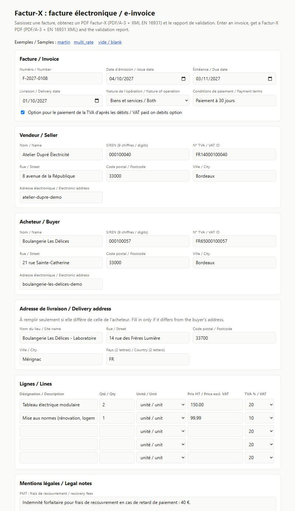
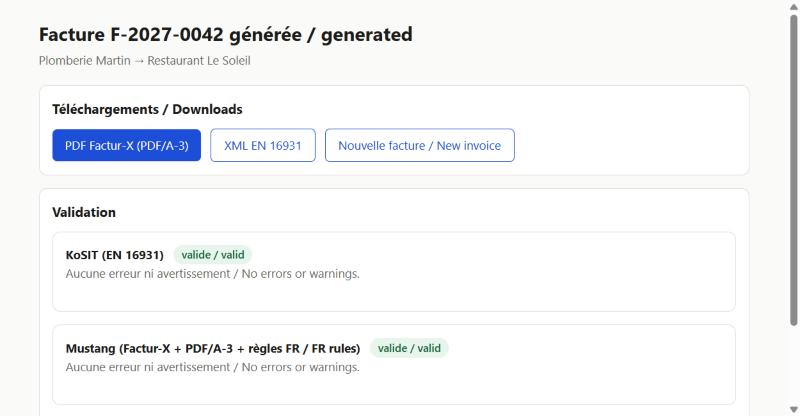

# factur-x-demo

[Français](#français) · [English](#english)

---

## Français

Démo publique : à partir des données d’une facture (entreprises **fictives**), elle produit une facture électronique **Factur-X** (PDF/A-3 avec XML EN 16931 intégré) et la fait valider par des validateurs de référence.




### Ce que fait la démo

1. Saisie d’une facture (ou chargement d’un exemple) : vendeur, acheteur, lignes, TVA, dates, mentions légales, adresse de livraison si elle diffère, option de paiement de la TVA d’après les débits.
2. Contrôle des données avant génération : SIREN (clé de contrôle), n° de TVA, adresses de l’acheteur et de livraison, mentions PMT/PMD/AAB, adresses électroniques, taux de TVA, dates. Les erreurs sont affichées en français et en anglais.
3. Génération du XML CII EN 16931 et du PDF Factur-X (PDF/A-3).
4. Validation par Mustang et KoSIT, avec le rapport affiché.
5. Téléchargement du PDF et du XML.

### Résultats de validation

Les deux exemples (`martin`, `multi_rate` : deux taux de TVA) sont vérifiés par les tests automatisés :

| Validateur | Version | Ce qui est vérifié | Résultat |
|---|---|---|---|
| KoSIT validator | 1.6.3 | Schéma Factur-X EN 16931 + règles CEN EN 16931 (CII 1.3.17) | 0 erreur, 0 avertissement |
| Mustang CLI | 2.26.0 | XML Factur-X, PDF/A-3B (veraPDF), règles françaises BR-FR « Flux 2 » V1.3.0 | valide, 0 avertissement |

Des factures volontairement fausses (total incorrect, schéma cassé) sont rejetées avec la bonne règle (`BR-CO-15`, `BR-CO-10`).

### Lancer le projet

Prérequis : [uv](https://docs.astral.sh/uv/) et, pour la validation, Docker.

```bash
uv sync
docker build -t facturx-validators:1 validators/
uv run uvicorn facturx_demo.web.app:app
```

Ouvrir http://127.0.0.1:8000. Sans Docker, la génération fonctionne mais la validation est indisponible.

Tests : `uv run pytest` (les tests qui ont besoin de Docker sont ignorés si Docker est absent).

### Limites

- Démo uniquement : pas de comptes, pas de paiement, pas de réception de factures, pas d’avoirs, pas d’envoi à une plateforme agréée.
- Taux de TVA gérés : 20, 10, 5,5 et 2,1 %. La liste officielle est plus large.
- L’option de paiement de la TVA d’après les débits est transmise dans le champ BT-8 (code 5 en CII). Le champ BT-8 est confirmé par la table officielle de la DGFiP (impots.gouv.fr, mise à jour août 2026) ; la valeur du code (5) n’y figure pas et reste à confirmer. La nature de l’opération est transmise dans BT-23 (B1, S1 ou M1).
- Les adresses électroniques et les mentions légales des exemples sont fictives. Ce n’est pas un conseil juridique ou fiscal : vérifiez les règles sur impots.gouv.fr et economie.gouv.fr.

### Contact

[github.com/wissem-ben-khalifa](https://github.com/wissem-ben-khalifa)

---

## English

A public demo: from invoice data (**fictional** companies) it produces a **Factur-X** e-invoice (PDF/A-3 with the EN 16931 XML embedded) and has it checked by reference validators.


### What it does

1. Enter an invoice (or load a sample): seller, buyer, lines, VAT, dates, legal notes, delivery address if different, VAT-on-debits option.
2. Checks the data before generating: SIREN (check digit), VAT number, buyer and delivery addresses, PMT/PMD/AAB notes, electronic addresses, VAT rates, dates. Errors are shown in French and English.
3. Generates the EN 16931 CII XML and the Factur-X PDF (PDF/A-3).
4. Validates with Mustang and KoSIT and shows the report.
5. Download the PDF and the XML.

### Validation results

Both samples (`martin`, and `multi_rate` with two VAT rates) are checked by the automated tests:

| Validator | Version | What is checked | Result |
|---|---|---|---|
| KoSIT validator | 1.6.3 | Factur-X EN 16931 schema + CEN EN 16931 rules (CII 1.3.17) | 0 errors, 0 warnings |
| Mustang CLI | 2.26.0 | Factur-X XML, PDF/A-3B (veraPDF), French BR-FR "Flux 2" rules V1.3.0 | valid, 0 warnings |

Deliberately wrong invoices (wrong total, broken schema) are rejected with the right rule (`BR-CO-15`, `BR-CO-10`).

### Run it

Requires [uv](https://docs.astral.sh/uv/) and, for validation, Docker.

```bash
uv sync
docker build -t facturx-validators:1 validators/
uv run uvicorn facturx_demo.web.app:app
```

Open http://127.0.0.1:8000. Without Docker, generation works but validation is unavailable.

Tests: `uv run pytest` (tests that need Docker are skipped when Docker is missing).

### Limits

- Demo only: no accounts, no payments, no receiving invoices, no credit notes, no sending to an approved platform.
- Supported VAT rates: 20, 10, 5.5 and 2.1 %. The official list is wider.
- The VAT-on-debits option is sent in field BT-8 (code 5 in CII). Field BT-8 is confirmed by the official DGFiP table (impots.gouv.fr, updated August 2026); the code value (5) is not listed there and still needs confirming. The nature of the operation is sent in BT-23 (B1, S1 or M1).
- The electronic addresses and legal notes in the samples are fictional. This is not legal or tax advice: check the rules on impots.gouv.fr and economie.gouv.fr.

### Contact

[github.com/wissem-ben-khalifa](https://github.com/wissem-ben-khalifa)

---

Built with Python, FastAPI, [drafthorse](https://github.com/pretix/python-drafthorse), [factur-x](https://github.com/akretion/factur-x), fpdf2, [Mustang](https://github.com/ZUGFeRD/mustangproject) and the [KoSIT validator](https://github.com/itplr-kosit/validator). Font: DejaVu Sans (see `src/facturx_demo/fonts/LICENSE`). License: MIT.
